# Diagrama de Casos de Uso

Atualizado em 23/11/2026 com as regras de negócio que entraram no app e no Firestore nas semanas 1 e 2.

```mermaid
flowchart LR
    PS["👤 Profissional de saúde<br/>(ACS, médico, nutricionista)"]
    MA["👤 Master"]
    MA -. herda tudo do .-> PS

    subgraph SIS["Sistema NutriMirim"]
        direction TB

        subgraph G1["Acesso"]
            direction TB
            UC01([Fazer login])
            UC02([Recuperar senha])
            UC03([Sair do app])
        end

        subgraph G2["Crianças"]
            direction TB
            UC10([Cadastrar criança - RF01])
            UC11([Buscar por nome ou CPF - RF11])
            UC12([Consultar dados da criança])
            UC13([Editar dados da criança])
            UC14([Desativar cadastro])
        end

        subgraph G3["Avaliações"]
            direction TB
            UC20([Registrar avaliação - RF02])
            UC21([Validar medidas pela OMS])
            UC22([Calcular z-score - RF03])
            UC23([Classificar no semáforo - RF04])
            UC24([Mostrar micro-condutas - RF13])
            UC25([Sugerir data de retorno - RF17])
            UC26([Alertar encaminhamento - RF12])
            UC27([Corrigir avaliação em até 15 min - RF14])
            UC28([Excluir avaliação em até 15 min - RF14])
        end

        subgraph G4["Consultas"]
            direction TB
            UC30([Consultar histórico - RF05])
            UC31([Ver curva de crescimento - RF06])
            UC32([Compartilhar relatório - RF10])
            UC33([Ver perfil e alterar microárea - RF18])
        end

        subgraph G5["Auditoria"]
            direction TB
            UC40([Informar motivo da alteração])
            UC41([Gravar log de auditoria - RNF11])
        end

        subgraph G6["Administração"]
            direction TB
            UC50([Gerenciar profissionais])
            UC51([Gerenciar UBS])
            UC52([Consultar logs de todas as UBS])
        end
    end

    PS --- G1
    PS --- G2
    PS --- UC20
    PS --- UC27
    PS --- UC28
    PS --- G4
    MA --- G6

    UC20 -. include .-> UC21
    UC20 -. include .-> UC22
    UC20 -. include .-> UC23
    UC23 -. include .-> UC24
    UC23 -. include .-> UC25
    UC26 -. extend: z-score crítico .-> UC23

    UC13 -. include .-> UC40
    UC14 -. include .-> UC40
    UC27 -. include .-> UC40
    UC28 -. include .-> UC40
    UC40 -. include .-> UC41
```

O Mermaid não tem um tipo próprio para casos de uso, então o diagrama usa um fluxograma: os atores ficam fora do retângulo do sistema e cada caso de uso é uma elipse. As setas tracejadas marcam `<<include>>` (sempre acontece junto) e `<<extend>>` (só acontece em certa condição). Quando um ator se liga a um grupo inteiro, ele participa de todos os casos de uso daquele grupo.

## Regras de negócio

| Regra | Onde vale | Casos de uso |
| --- | --- | --- |
| Cada profissional só lê e grava dados das UBS da própria lista (`ubsIds`). O master acessa todas. | `firestore.rules` | Todos os de crianças e avaliações |
| Todos os papéis comuns (ACS, médico e nutricionista) têm as mesmas permissões. | `firestore.rules` | Todos do profissional |
| Nada é apagado pelo app. A criança é desativada (`ativa: false`) e a avaliação é marcada como excluída (`excluida: true`). | regras e repositórios | Desativar cadastro, Excluir avaliação |
| Editar ou desativar uma criança e corrigir ou excluir uma avaliação exigem um motivo de 3 a 200 caracteres. | repositórios e regras | Informar motivo |
| Toda alteração grava, no mesmo lote, um log imutável em `alteracoes/{versao}` com quem alterou, quando, o motivo e os valores anteriores. | regras | Gravar log de auditoria |
| Só o autor corrige ou exclui uma avaliação, e só até 15 minutos depois do registro. O master pode a qualquer momento. | repositórios e regras | Corrigir e Excluir avaliação |
| Uma criança desativada não pode ser editada nem receber avaliação. | telas, repositórios e regras | Editar dados, Registrar avaliação |
| Uma avaliação precisa ter pelo menos um indicador (`pi`, `ei`, `pe` ou `imci`). | repositórios e regras | Registrar e Corrigir avaliação |
| O CPF do responsável precisa ter 11 dígitos e dígito verificador válido. O telefone precisa ter 10 ou 11 dígitos. | validadores e repositórios | Cadastrar e Editar criança |
| O profissional só altera a própria microárea. Nome, papel e UBS são definidos pelo master. | regras | Ver perfil, Gerenciar profissionais |
| O app não tem cadastro público de conta. Quem cria contas é o master. | Firebase Auth | Gerenciar profissionais |

## Situação no app

- Login, recuperação de senha e saída já têm as telas, mas ainda não estão ligados ao Firebase Auth (falta o `AuthService`).
- Gerenciar profissionais, gerenciar UBS e consultar todos os logs já são permitidos pelas regras do Firestore, mas ainda não têm tela no app.
- Corrigir e excluir avaliação já existem nos repositórios, mas ainda não têm tela.
