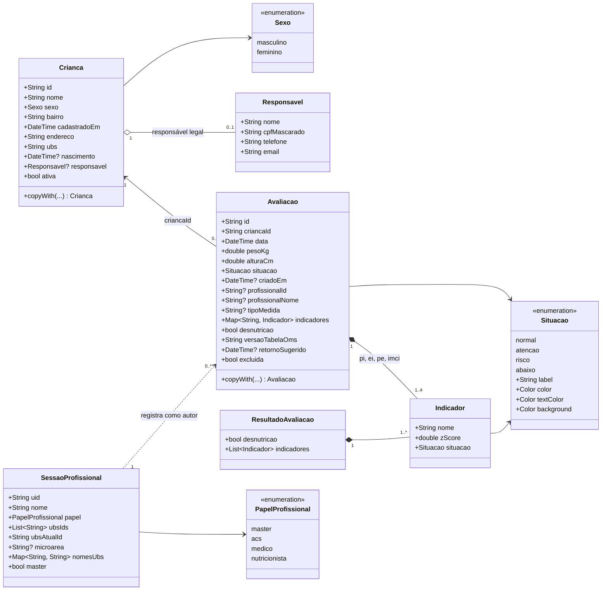
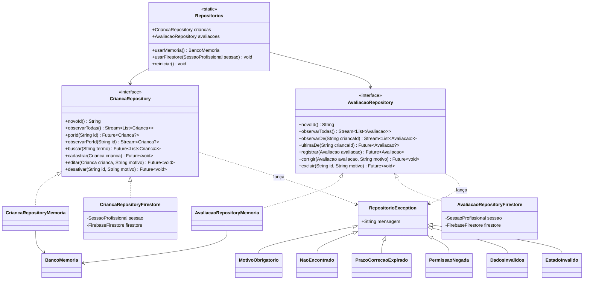

# Diagrama de Classes (Modelos de Domínio)

Classes de `lib/data/models.dart` e `lib/repositories/`, como estão no código em 23/11/2026.

## Modelos de domínio

## Repositórios

As telas só acessam os dados por `Repositorios.criancas` e `Repositorios.avaliacoes`. Cada interface tem duas implementações: a de memória é a padrão do app e dos testes, e a do Firestore é ativada depois do login.

## Observações

- `Crianca.ubs` guarda o nome da UBS para exibir na tela. No Firestore é gravado o id (`ubsId`), que vem da sessão (`SessaoProfissional.ubsAtualId`).
- `Avaliacao.criancaId` é a associação com `Crianca`: uma criança tem zero ou mais avaliações, e cada avaliação pertence a uma única criança.
- `Avaliacao.indicadores` usa as chaves fixas `pi` (peso/idade), `ei` (estatura/idade), `pe` (peso/estatura) e `imci` (IMC/idade). O repositório exige pelo menos uma delas.
- `profissionalId`, `profissionalNome` e `criadoEm` são preenchidos pelo repositório a partir da sessão, e não pela tela.
- Não existe uma classe `Ubs` nem uma classe `Profissional` no Dart. Esses dados ficam no Firestore e chegam ao app pela `SessaoProfissional`.
